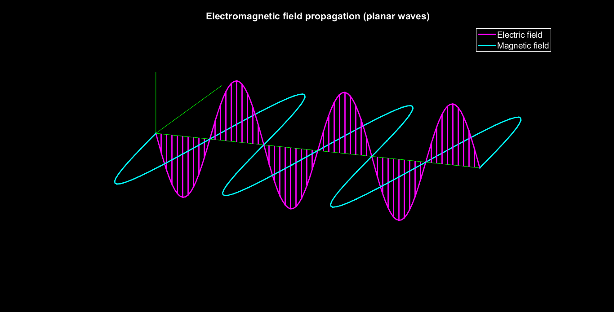

# 3D Electromagnetic Wave Propagation Simulation

Numerical simulation and 3D visualization of planar transverse electromagnetic (TEM) wave propagation implemented in MATLAB.



## Overview
In planar electromagnetic waves traveling through free space, the electric field ($\vec{E}$) and magnetic field ($\vec{B}$ / $\vec{H}$) propagate perpendicularly to each other and to the direction of propagation ($\vec{k} = \vec{E} \times \vec{B}$), satisfying Maxwell's equations.

This simulation models:
- **Transverse E & B Fields**: Orthogonal phase-coupled harmonic wave oscillation.
- **Dynamic 3D Vector Rendering**: Spatial stem-vector representations along the propagation axis.
- **Automated GIF Compilation**: Frame capture and color quantization to generate dynamic simulation media.

## Technical Details
- **Environment**: MATLAB / GNU Octave compatible
- **Core Math**: Vector spatial rotation matrix ($R_x(-\pi/2)$) mapping electric potential to magnetic field density.
- **Rendering**: 3D spatial perspective (`plot3`, `stem3`), dynamic camera elevation/azimuth control (`view([21, 40])`).

## How to Run
1. Open MATLAB or GNU Octave.
2. Navigate to the `src/` directory.
3. Run the script:
   ```matlab
   EB_field_propagation_animation